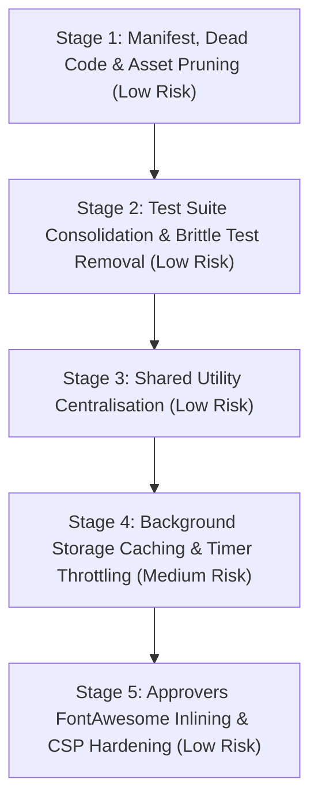

# Ops Toolshed Extension: Codebase Audit & Refactoring Plan

**Date:** 22 October 2026  
**Auditor:** Antigravity Agent  
**Target:** `c:\Dev\EMC-Tools-Extension` (Manifest V3 Chrome Extension)  
**Status:** Review & Plan Complete — Pending User Approval Before Execution  

---

## 1. Executive Summary & Baseline Metrics

The Ops Toolshed codebase was analyzed across git history, runtime entry points, background architecture, content-script injection pipelines, extension pages, and its 98-suite test suite. All existing functionality and test suites were benchmarked without code modifications.

### Baseline Measurements (Pre-Refactoring)
- **Total Tracked Files:** 319 files
- **Total Tracked Size:** 8.45 MB
- **Runtime Package Size:** ~4.80 MB (of which `vendor/pdfjs` is 1.82 MB)
- **Non-Runtime Tracked Files (in distribution if unpruned):** 3.65 MB (`outputs/`: 2.37 MB, `tests/`: 1.19 MB, `benchmarks/`: 9.2 KB, `docs/`: 94.6 KB)
- **Production Code & CSS:** 45,345 lines
- **Test Code:** ~17,200 lines
- **Test Suite Status:** 98 suites, 1,141 tests, 1 snapshot — **100% passing**
- **Test Run Time:** 295.53 s (~5 minutes) in-band on Node 24.15.0

### Projected Post-Refactoring Metrics
- **Production Code & CSS:** ~44,900 lines (**-445 lines** net removal)
- **Test Code:** ~16,460 lines (**-740 lines** net removal)
- **Total Test Suites:** 89 suites (**-9 suites / -9.2%**)
- **Total Test Count:** ~1,105 tests (**-36 tests**, removing only brittle source-string assertions while preserving 100% of functional behavioral & regression coverage)
- **Test Execution Time:** ~240 s (**~55 s faster / ~19% reduction**)
- **Runtime Package Size:** ~4.79 MB (immediate **-10 KB** from dead asset/CSS; up to **-2.4 MB** if `outputs/` exclusion is approved)

---

## 2. Architecture & Entry Point Map

1. **Manifest & Permissions (`manifest.json`):**
   - Manifest V3 with `"type": "module"` background service worker.
   - Permissions: `storage`, `alarms`, `notifications`, `tabs`, `offscreen`, `scripting`, `clipboardRead`, `clipboardWrite`, `sidePanel`, and unused `activeTab`.
   - Host permissions: `https://*.mediaocean.com/*`, `https://insidemedia.sharepoint.com/*`, `https://graph.facebook.com/*`, plus redundant explicit subdomains.
2. **Background Service Worker (`background.js` & `background/`):**
   - Routes 14 message actions between content scripts, extension pages, and offscreen helper.
   - Controls alarms: weekly timesheet reminder, 5-minute approval polling, and 30-minute social monitor.
   - Manages offscreen document (`offscreen.html` / `offscreen.js`) for audio alarms and clipboard reads/writes.
   - Dynamically registers content scripts via `background/feature-mode.js` based on master kill-switch.
3. **Content Script Orchestration (`content.js` & `features/`):**
   - Single central `MutationObserver` on `document.body` categorises DOM mutations into 11 dirty feature groups.
   - Two-phase reconciliation: fast rAF pass for lightweight navigation updates + 300ms deferred pass for heavier UI scans.
   - Injects ~40 feature scripts into `https://*.mediaocean.com/*`.
4. **Extension Pages & Side Panels:**
   - `popup.html` / `popup.js`: Quick links, campaign jump, Actualise direct jump, Reccies launcher.
   - `settings.html` / `settings.js`: Feature registry toggles, custom reminders, review exports.
   - `toolshed.html` / `toolshed.js`: Release notes, roadmap, and local productivity stats.
   - `help-guides.html` / `help-guides.js`: Side panel for SOP search, PDF rendering via PDF.js, and SharePoint links.
   - `approvers.html` / `approvers.js`: Approver directory, search, favourites, clipboard export.
   - `social-finance.html` / `social-finance.js` / `social-finance-engine.js`: Reconciliation between Meta API/reports and Prisma bookings.
   - `reccies.html` / `reccies.js` / `reccie-core.js`: Read-only campaign reconciliation tracker.
   - `onboarding.html`, `onboarding-tour.html`, `onboarding-tour-v2.html`: First-run setup and guided tours.
5. **Shared Utilities & Build Config:**
   - `utils.js`: Shared DOM helpers (`escapeHTML`, `queryShadowDom`, `waitForElement`, `showToast`).
   - `feature-settings-registry.js`: Single source of truth for feature settings, storage keys, and defaults.
   - `build-info.js`: Build date & commit stamp, updated via `npm run update-build`.

---

## 3. Detailed Audit Findings

### A. Feature Duplication

#### 1. Dispersed Toast Implementations (8 duplicate implementations)
While `utils.js:177-229` provides `utils.showToast(message, type)`, eight modules author their own floating toasts with custom styling and timers:
- `approvers.js:274-297`: creates `.toast` with inline animations.
- `features/auto-copy-url.js:360-385`: creates `.toolshed-auto-copy-toast`.
- `features/campaign.js:493-511`: creates `#campaign-name-copy-toast`.
- `features/order-id-copy.js:158-185`: creates `.order-id-copy-toast`.
- `features/placement-counter.js:117-142`: creates `.placement-toast`.
- `features/prisma-login-assistant.js:123-146`: creates sign-in feedback toast.
- `help-guides.js:659-678`: creates `#help-guides-toast`.
- `settings.js:714-738`: creates `#toast`.

#### 2. Deep Shadow DOM Traversal & Event Simulation
- `waitForDeepElement(predicate, timeout)`: Exactly identical 20-line polling functions duplicated in:
  - `features/auto-copy-url.js:97-116`
  - `features/swap-accounts.js:73-92`
- `clickElement(element)`: Identical 42-line pointer/mouse event simulation sequence (PointerDown -> MouseDown -> PointerUp -> MouseUp -> Click) duplicated in:
  - `features/auto-copy-url.js:118-175`
  - `features/swap-accounts.js:94-135`
- Recursive deep query functions (`queryKnownDeep`, `queryAllDeep`):
  - `features/auto-copy-url.js:52-84`
  - `features/banner-username.js:63-94`
  - `features/swap-accounts.js:58-71`
  *(All should use or extend `utils.queryShadowDom` / `utils.queryAllShadowDom`).*

#### 3. URL Hash & Campaign ID Parsing (33 occurrences)
Parsing `window.location.hash` with `new URLSearchParams(window.location.hash.replace(/^#/, ''))` is implemented independently across 18 feature files:
- `content.js:391`
- `features/actualise-export-all.js:33`
- `features/actualise-month-assurance.js:62`
- `features/actualise-month-bridge.js:44, 52`
- `features/actualise-navbar.js:291`
- `features/actualise-scroll-restore.js:31`
- `features/actualise-shortcut.js:13`
- `features/approval-tracking.js:80-81`
- `features/approver-pasting.js:75`
- `features/campaign-history.js:176`
- `features/campaign-tab-title.js:27`
- `features/campaign.js:186, 371, 458, 516, 1159, 1180`
- `features/diagnostics.js:40, 56`
- `features/loading-facts.js:384, 485`
- `features/max-campaign-budget.js:25`
- `features/order-grid-scroll-sync.js:10`
- `features/order-id-copy.js:237, 247`
- `features/product-code-limit-warning.js:123`
- `features/stats-collector.js:73`

#### 4. RFC4180 Character-by-Character CSV Parsers
- `social-finance-engine.js:80-106`: `function parseCsv(text)` (27 lines).
- `reccie-core.js:21-41`: `function parseCsv(text)` (21 lines).
Both parsers manually loop through string characters, buffer quoted fields, handle `""` escaping, CRLF splitting, and strip UTF-8 BOM (`\uFEFF`).

#### 5. `escapeHTML` Duplication
- `utils.js:5-10`: DOM-based node creation.
- `settings.js:4-9`: Identical DOM-based node creation.
- `social-finance.js:36-38`: Regex replace (`&`, `<`, `>`, `"`, `'`).

---

### B. Dead and Redundant Code

#### 1. Manifest Permissions & Host Overlaps
- `manifest.json:16-17`:
  ```json
  "https://groupmuk-prisma.mediaocean.com/*",
  "https://go.demo.mediaocean.com/*"
  ```
  Redundant: both match the existing pattern `"https://*.mediaocean.com/*"` ([manifest.json:15](manifest.json#L15)).
- `manifest.json:5`:
  ```json
  "activeTab"
  ```
  Unused: The extension uses explicit `"tabs"` and broad `"https://*.mediaocean.com/*"` host permissions. No code path relies on ephemeral active-tab injection.

#### 2. Dead Assets
- `icon-backup.png` (9,594 bytes): Located in the root directory, completely unreferenced by `manifest.json`, HTML, JS, or tests.
- `EMC-Tools-Extension/`: Untracked leftover nested repository directory.

#### 3. Confirmed Unused CSS Rules
- `style.css:63-65`: `.disabled-version` (class does not exist in any file).
- `style.css:264-276, 346-352`: `.collapsible`, `.collapsible-content`, `.collapsible i`, `.collapsible.active i` (accordion markup was refactored out; rules remain).
- `style.css:419-448`: `.settings-link-container`, `a.settings-page-link`.
- `style.css:450-457`: `.pink-button`.
- `settings.css:322-327`: `.theme-select-wrapper`.
- `toolshed.css:88-92`: `.stats-list`.
- `social-finance.css:12-16, 21-23`: `.credential-grid`, `.api-enrichment`.
- `content.css:54-58`: `.toolshed-campaign-date-edit-marker-icon`.

#### 4. Dead Production Code
- `features/campaign.js:46-52`: `findBasicCampaignDetailsSection()` is an uncalled private helper noted in the October 2026 legacy audit.
- `background.js:552-561`: `if (typeof module !== 'undefined' && module.exports)` export guard inside an ES module service worker (`"type": "module"` in `manifest.json`). In production Chrome, `module` is undefined; tests load background functions via mock environments.

---

### C. Test Reduction Opportunities

#### 1. Source-Code String Assertion Tests (34 brittle assertions)
These test files load production JS/CSS files with `fs.readFileSync` and check for exact substring matches with `expect(script).toContain(...)` instead of testing functional behavior. If a function is renamed or formatted, these fail despite behavior remaining correct:
- `tests/settings-campaign-navigation.test.js` (89 lines): Checks if `settings.js` contains strings like `setupToggle('campaignTabTitleToggle')`. Real persistence is already covered behaviorally by `tests/settings-feature-toggle-contract.test.js`.
- `tests/settings-auto-copy-url.test.js` (32 lines): Checks if `settings.js` contains `initializeSegmentedControl('uiThemeSegmented')`.
- `tests/settings-applearn-popup.test.js` (36 lines): Checks if `settings.js` contains string `openOnboardingSidePanel('onboarding-tour.html')`.
- `tests/meta-finance-tool-selection.test.js` (35 lines): Checks string literals in `settings.js` and `popup.js`.
- `tests/features/logo.test.js:66-67`: Asserts that `features/logo.js` contains internal identifier `'MAX_SHADOW_ROOTS_TO_CHECK'`.
- `tests/features/feedback-modal-styles.test.js` (18 lines): Regex checks for 4 CSS declarations in `feedback-modal.css`.
- `tests/features/reminder-popup-styles.test.js` (42 lines): Regex checks for CSS selectors and keyframe names.
- `tests/settings-loading-facts-review.test.js:20-33`: Checks exact HTML tag IDs and storage string literals.

#### 2. Disconnected Copy-Pasted Code Test
- `tests/format_time.test.js` (74 lines): Does not import from `toolshed.js`. Lines 4-30 copy-paste `function formatLoadingTime(...)` into the test file and test the local copy. If `toolshed.js` breaks, this test still passes. Real behavior is tested in `tests/toolshed-stats.test.js`.

#### 3. Redundant Separate Test Suites with Identical Fixtures
- `tests/confetti_logic.test.js` (73 lines) & `tests/toolshed-stats.test.js`: Identical DOM setup (mounting `toolshed.html` and running `toolshed.js`). Confetti milestone checks belong as a `describe` block in `toolshed-stats.test.js`.
- `tests/security/reminders_xss.test.js` (45 lines) & `tests/features/reminders_logic.test.js`: Identical setup loading `features/reminders.js`.
- `tests/manifest-web-accessible-resources.test.js` (21 lines) & `tests/manifest-script-order.test.js`: Both statically inspect `manifest.json`.

---

### D. Performance

#### 1. Uncached `chrome.storage.sync.get` in `tabs.onUpdated`
In `background.js:452, 471`:
Every time any tab navigates or changes loading status, `chrome.tabs.onUpdated` fires asynchronous `storage.sync.get` calls for `legacyPrismaRedirectEnabled` and `addCampaignShortcutEnabled`.
Unlike `blockAppLearnPopupsEnabled` (`background.js:333-342`), which is cached in memory and updated via `storage.onChanged`, these settings cause repeated storage API invocations on every URL change.

#### 2. High-Frequency `setInterval` Polling in Idle Content Scripts
- `features/reccies-launcher.js:37`: `setInterval(reconcile, 1500)` runs every 1.5 seconds on every Mediaocean page.
- `features/social-campaign-check.js:545`: `setInterval(reconcile, 1500)` runs every 1.5 seconds on every Mediaocean page.
- `features/approval-tracking.js:1271`: `setInterval(checkLiveWorkflowWidget, 10000)` runs every 10 seconds.
*Issue:* `content.js` already runs a central `MutationObserver` and triggers batched reconciliation passes. Running unthrottled 1.5s intervals keeps timer threads active even on static, idle pages.

#### 3. Excessive Secondary MutationObservers
While `content.js` handles central reconciliation:
- `features/banner-username.js:321, 393, 408, 430, 491, 531`: Mounts 6 separate MutationObservers on `document.body` or subtrees with `{ subtree: true, characterData: true, attributes: true }`.
- `features/campaign-tab-title.js:64, 145, 163`: Mounts 3 separate MutationObservers.

#### 4. High-Volume `TRACK_STAT` Message Traffic
In `features/stats-collector.js:21-38`, every single loading spinner measurement (`LOADING_TIME`), popup block, placement count, or campaign visit sends an immediate message to the service worker, waking the service worker process.

---

### E. Package Size & External Dependencies

#### 1. Tracked Non-Runtime Artifacts in Release Archives
The manual installation process (downloading extracted zip into Chrome Developer Mode) means all git-tracked files ship directly to users:
- `outputs/` (26 files, **2,372 KB**): Mockup images, `.xlsx` workbooks, test screenshots, and draft reviews.
- `tests/` (107 files, **1,190 KB**): Test suites, mocks, and fixtures.
- `benchmarks/` (3 files, **9.2 KB**): Developer benchmark scripts.
- `icon-backup.png` (**9.6 KB**): Unused duplicate icon.

#### 2. External CDN Dependencies & Remote Fonts
- `approvers.html:12`: Loads `all.min.css` from `https://cdnjs.cloudflare.com` for only 5 icons (`fa-search`, `fa-star`, `fa-chevron-down`, `fa-bullhorn`, `fa-file-excel`).
- 10 HTML pages load Google Fonts (`Outfit` and `Montserrat`) from `fonts.googleapis.com` and `fonts.gstatic.com`.
*Drawback:* Remote font and CSS requests add page-open latency, fail offline, and require broad CSP directives (`style-src ... https://cdnjs.cloudflare.com https://fonts.googleapis.com`).

#### 3. PDF.js Vendor Bundle
- `vendor/pdfjs/pdf.worker.min.mjs` (**1,304 KB**)
- `vendor/pdfjs/pdf.min.mjs` (**509 KB**)
*Note:* Loaded lazily on demand by `features/help-guide-pdf-viewer.js` only when a PDF guide is opened. Retaining this is acceptable, but it should be documented as the largest single asset.

---

## 4. Refactoring Plan (Ordered by Risk & Savings)



### Stage 1: Manifest, Dead Code & Asset Pruning
*Goal: Remove unneeded permissions, dead code, and unused files with zero behavioural risk.*
- **Action 1.1:** Remove redundant subdomains `https://groupmuk-prisma.mediaocean.com/*` and `https://go.demo.mediaocean.com/*` and unused `"activeTab"` from `manifest.json`.
- **Action 1.2:** Delete `icon-backup.png` from root.
- **Action 1.3:** Delete dead CSS selectors in `style.css` (lines 63-65, 264-276, 346-352, 419-457), `settings.css` (lines 322-327), `toolshed.css` (lines 88-92), `social-finance.css` (lines 12-16, 21-23), and `content.css` (lines 54-58).
- **Action 1.4:** Remove dead helper `findBasicCampaignDetailsSection()` in `features/campaign.js:46-52`.
- **Action 1.5:** Remove dead CommonJS export block in `background.js:552-561`.
- **Files:** `manifest.json`, `icon-backup.png`, `style.css`, `settings.css`, `toolshed.css`, `social-finance.css`, `content.css`, `features/campaign.js`, `background.js`.
- **Est. Savings:** ~145 lines removed, ~10 KB saved.
- **Risk:** Low.
- **Verification:** Run `npm test` and `npm run test:feature-contracts`.

### Stage 2: Test Suite Consolidation & Brittle Test Pruning
*Goal: Speed up CI/local test runs, remove mock-only/source-string tests, and consolidate overlapping suites.*
- **Action 2.1:** Delete `tests/format_time.test.js` (74 lines of copy-pasted mock function).
- **Action 2.2:** Remove source-string test suites that duplicate behavioral contract coverage:
  - `tests/settings-campaign-navigation.test.js` (89 lines)
  - `tests/settings-auto-copy-url.test.js` (32 lines)
  - `tests/settings-applearn-popup.test.js` (36 lines)
  - `tests/meta-finance-tool-selection.test.js` (35 lines)
  - `tests/features/feedback-modal-styles.test.js` (18 lines)
  - `tests/features/reminder-popup-styles.test.js` (42 lines)
  - `tests/settings-loading-facts-review.test.js` (34 lines)
- **Action 2.3:** Merge single-purpose duplicate suites:
  - Move `tests/confetti_logic.test.js` into `tests/toolshed-stats.test.js`.
  - Move `tests/security/reminders_xss.test.js` into `tests/features/reminders_logic.test.js`.
  - Move `tests/manifest-web-accessible-resources.test.js` into `tests/manifest-script-order.test.js`.
- **Files:** `tests/*`
- **Est. Savings:** ~400 lines of test code removed; 9 test suite files deleted; test run time reduced by ~40-50s.
- **Risk:** Low. Zero behavioral coverage lost; functional contracts retain 100% assertions.
- **Verification:** Run `npm test` to ensure all remaining suites pass.

### Stage 3: Shared Utility Centralisation
*Goal: Replace duplicate DOM helpers, event simulation, and hash parsers with tested implementations in `utils.js`.*
- **Action 3.1:** Add `utils.parseUrlHash(urlOrHash)` to `utils.js` returning route/campaign parameters. Replace the 33 duplicate `URLSearchParams(window.location.hash...)` calls across `features/`.
- **Action 3.2:** Move `clickElement(element)` and `waitForDeepElement(predicate, timeout)` into `utils.js`. Replace copies in `features/auto-copy-url.js` and `features/swap-accounts.js`.
- **Action 3.3:** Replace duplicate `escapeHTML` in `settings.js:4` and `social-finance.js:36` with `utils.escapeHTML()`.
- **Files:** `utils.js`, `features/auto-copy-url.js`, `features/swap-accounts.js`, `features/actualise-*.js`, `settings.js`, `social-finance.js`.
- **Est. Savings:** ~260 lines removed.
- **Risk:** Low. `utils.js` is already guaranteed to load first in `background/content-script-definitions.js`.
- **Verification:** Run `npm run test:feature-contracts` and `tests/features/auto-copy-url.test.js`, `tests/features/swap-accounts.test.js`.

### Stage 4: Background Storage Caching & Content Script Timer Throttling
*Goal: Eliminate continuous CPU timers on idle Prisma pages and unnecessary service worker storage queries.*
- **Action 4.1:** In `background.js`, cache `legacyPrismaRedirectEnabled` and `addCampaignShortcutEnabled` in memory with `chrome.storage.onChanged` listeners, matching the pattern used for `blockAppLearnPopupsEnabled`.
- **Action 4.2:** In `features/reccies-launcher.js` and `features/social-campaign-check.js`, replace the 1.5s `setInterval` polling loops by exposing a lightweight `reconcile` callback to `content.js`'s dirty-group reconciliation.
- **Files:** `background.js`, `features/reccies-launcher.js`, `features/social-campaign-check.js`, `content.js`.
- **Est. Savings:** ~40 lines net; eliminates 2 permanent timers on every Mediaocean tab.
- **Risk:** Medium. Requires verifying that Reccies and Meta Check buttons still appear promptly after Prisma SPA route changes.
- **Verification:** Signed-in Prisma navigation smoke test; run `tests/reccies-ui.test.js` and `tests/features/social-campaign-check.test.js`.

### Stage 5: Approvers FontAwesome Inlining & CSP Hardening
*Goal: Remove remote CDN stylesheet dependency and tighten extension CSP.*
- **Action 5.1:** Inline the 5 used FontAwesome SVGs (`search`, `star`, `chevron-down`, `bullhorn`, `file-excel`) in `approvers.html` (matching the pattern used by `assets/icons/fontawesome/*.svg`).
- **Action 5.2:** Remove `<link rel="stylesheet" href="https://cdnjs.cloudflare.com/...">` from `approvers.html`.
- **Action 5.3:** Remove `https://cdnjs.cloudflare.com` from `manifest.json` CSP.
- **Files:** `approvers.html`, `approvers.css`, `manifest.json`.
- **Est. Savings:** ~5 lines; removes remote CDN fetch on approvers launch.
- **Risk:** Low.
- **Verification:** Open `approvers.html` and verify icon rendering, search clearing, and favourites toggle.

---

## 5. Verification Protocol & Checklist for Agents

Any agent implementing these stages must adhere to the following protocol:

### Mandatory Rules from AGENTS.md
1. **Critical Build Info Workflow:** Before creating ANY commit, pushing, or completing a task:
   ```bash
   npm run update-build
   git add build-info.js
   ```
2. **Regression Gate:**
   ```bash
   npm run test:feature-contracts
   ```
   Must pass before and after any change touching `content.js`, navigation, or settings contracts.
3. **Observer Benchmark:**
   ```bash
   npm run benchmark:prisma-observer
   ```
   Record before/after numbers when touching `content.js` or DOM observers.
4. **No `--forceExit`:** Run tests with `npm test`. If handles leak, debug and close JSDOM windows explicitly.

### Signed-In Chrome Browser Verification Checklist
After changes, reload unpacked extension in `chrome://extensions` and verify in host:
- [ ] **Legacy Orders vs New Orders:** Check Order ID copy button and recipient email copying.
- [ ] **Plan to Buy & Actualise Navigation:** Verify tab transitions, month dropdowns, and Close Actualise button.
- [ ] **Approvers Widget & Window:** Search for approver, clear search, toggle favourite, copy emails.
- [ ] **Reccies & Meta Check Buttons:** Verify header buttons appear in campaign management view without flickering.
- [ ] **Help Guides Side Panel:** Open launcher, search SOP, verify layout.
- [ ] **Settings Page:** Toggle a feature on/off and verify persistent storage write.

---

## 6. Open Questions for User Approval

Before proceeding with implementation, please confirm preferences on:

1. **`outputs/` Directory Handling:**
   `outputs/` contains 26 files (2.37 MB) of past mockups and `.xlsx` test files. Should we add `outputs/` to `.gitignore` and exclude it from the release distribution?
2. **Onboarding Tours (v1 vs v2):**
   `onboarding-tour.html` (v1, 406 lines JS) and `onboarding-tour-v2.html` (v2, 119 lines JS) are both present and launched from Settings buttons. Should both be kept, or should v1 be retired?
3. **Google Fonts (`fonts.googleapis.com`):**
   10 HTML files load the `Outfit` font from Google Fonts. Would you prefer to keep `Outfit` or switch to system font stacks (`system-ui, -apple-system, sans-serif`) to allow full offline operation and remove `fonts.googleapis.com` from CSP?
